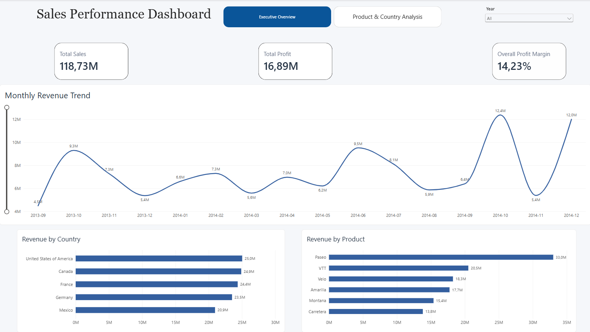
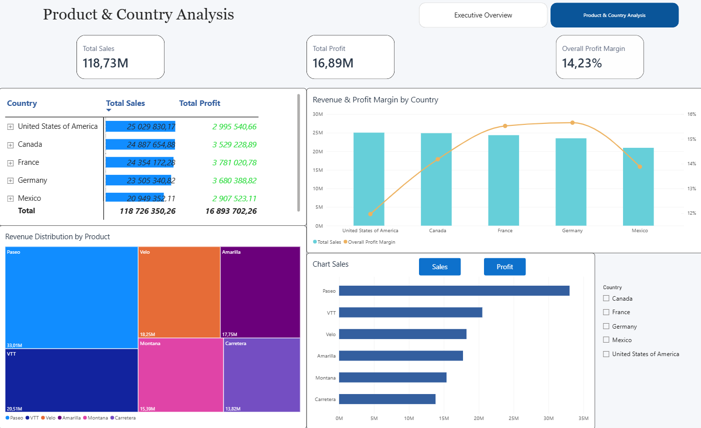

# Sales Performance Analytics — Power BI

Интерактивный аналитический дашборд для исследования продаж, прибыли и рентабельности по странам, продуктам и периодам.

## Инструменты

- Power BI Desktop
- Power Query — очистка и преобразование данных
- DAX — расчёт аналитических показателей
- Моделирование данных — связи между таблицами

## Основные показатели

- Общая выручка: 118,73 млн
- Общая прибыль: 16,89 млн
- Рентабельность продаж: 14,23%

## Реализованные возможности

- Анализ динамики выручки по месяцам
- Сравнение продаж и рентабельности по странам
- Анализ результатов по продуктам
- Интерактивная фильтрация
- Drill Down и Drillthrough
- Переключение визуализаций с помощью Bookmarks
- Расчёт показателей с использованием DAX

## Страницы отчёта

### Executive Overview

### Product & Country Analysis

## Файл Power BI

[Скачать проект Power BI](Sales_Performance_Analytics.pbix)
